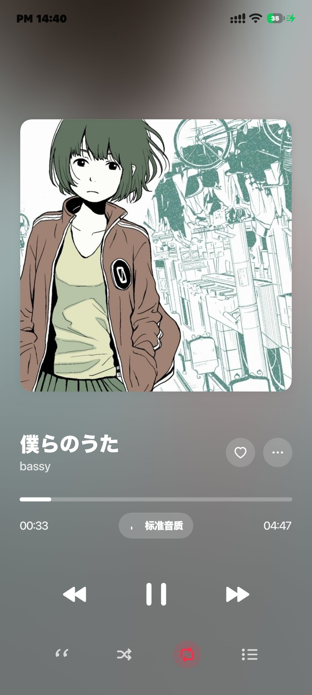
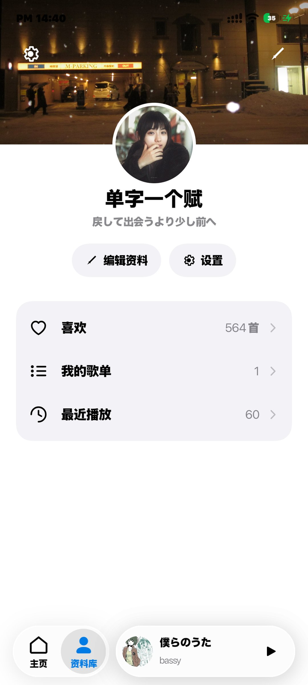
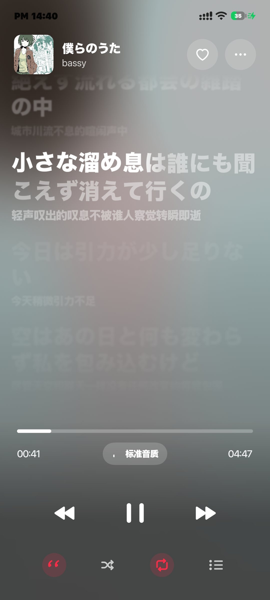
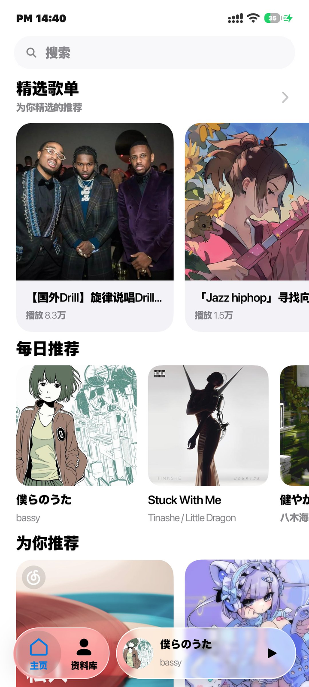
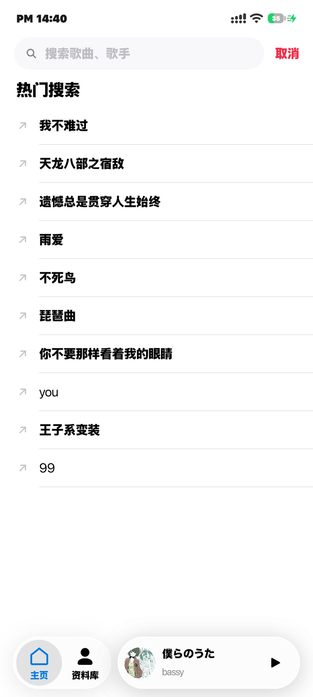

[English](./README_EN.md) | [中文](./README.md)

<h1 align="center">云音 (YunYin)</h1>

<div align="center">

<h3>✨ 一个把多源逐字歌词、流体背景与液态玻璃做进原生 Android 的网易云播放器 🎵</h3>

<p>
  <a href="https://github.com/Fu-craft/YunYin/releases">
    
  </a>
  <a href="https://github.com/Fu-craft/YunYin/releases">
    
  </a>
  
  
  
  <a href="https://fu-craft.github.io/YunYin/">
    
  </a>
</p>

<p>
  非官方第三方客户端，与网易云音乐、Apple 均无关联。
</p>

<p>
  项目采用 Kotlin + Jetpack Compose 全原生开发，支持 Android 13 (API 33) 及以上设备，
  围绕「逐字歌词、播放手感、视觉一致、可恢复运行」持续打磨。
</p>

🛠️ <strong>Active development / 持续迭代中</strong>

</div>

> [!WARNING]
> 本项目仅供学习与研究使用，请勿用于任何非法用途。
> 请只在你拥有权利、授权或第三方平台规则允许的范围内访问、播放或保存内容。
> 本项目不提供任何媒体内容、账号、密钥，也不提供规避付费 / DRM / 地区限制的方案。

> [!NOTE]
> 云音不运营任何云端曲库或媒体分发服务。所有内容均来自你自己部署的
> **NeteaseCloudMusicApi** 实例，账号能力取决于该实例与网易云平台的授权状态，
> 会员或受限内容仍需遵循平台规则。仓库不包含 API 地址、私钥或任何凭据。

---

## 快速定位 / Start here

- 只想体验：看 [快速体验](#快速体验--getting-started)
- 想了解能做到什么：看 [项目亮点](#项目亮点--why-it-stands-out) 与 [核心特性](#核心特性--key-features)
- 想自己构建 / 自部署 API：看 [构建](#构建--build)
- 想二次开发或了解取舍：看 [实现概览](#实现概览--implementation-notes)

```text
云音 YunYin
├── 逐字歌词：多源竞速 + 探针预取 + 逐字渐变 + 对唱 + 翻译
├── 播放手感：双 ExoPlayer 交叉淡入、无缝衔接、五档音质、试听识别
├── 视觉体系：液相玻璃材质、5 种流体背景、形变转场、无卡片分组列表
├── 本地能力：下载中心（断点续传）、本地音乐（内嵌封面 / 分组 / 搜索）
└── 可恢复运行：崩溃栈入诊断日志、状态四态容错、CI 单测 + 构建门禁
```

## 项目简介 / About

云音是一个基于 **Kotlin + Jetpack Compose + Media3** 的原生 Android 音频播放器，
单模块（`:app`）实现，主源码约 **216 个文件 / 45.3k 行**，
配套 **106 个测试文件 / 727 个单元测试**。

它不构建公共云端服务，而是在你自己部署的网易云 API 基础上，
把「歌词、播放、下载、本地音乐」四件事做深，并保持一套自洽的视觉语言。

当前定位：

- **接口自持**：API 地址在构建时注入（`api.base.url`），仓库不含任何服务端点。
- **歌词优先**：逐字歌词不是附加项，而是默认体验；无逐字时才回退整行。
- **本地优先**：下载、本地音乐、喜欢、歌单、设置全部落在设备本地。
- **视觉一致**：玻璃材质、圆角、动效曲线、字号层级来自同一套令牌（`Motion.*` / `AppleShapes` / `AppTheme.palette`）。
- **可诊断**：崩溃栈、ANR 线索、音源解析诊断统一写入可复制的日志文件。

---

## 项目亮点 / Why it stands out

- **逐字歌词是「竞速 + 探针」两段式，不是串行回退**：
  `LyricSourceRace` 并发请求多源（网易云 YRC、QQ、酷我、酷狗、AMLL TTML 镜像），
  先到先评；`LyricProbeRules` 用 **2.5 秒探针**决定是否继续等待更好的逐字结果，
  命中判定为 `tx > wy > amll > kw > kg`。
  「探针-再一次性绘制」避免歌词在半成品状态反复跳变，切歌后待判定完成再渐入。

- **逐字填充是渐变擦除，不是硬切**：
  `KaraokeLineText` 按音节计算进度，生成水平渐变画刷，
  边缘柔化宽度 **100 px**（与 Apple Music Android 端取值一致），
  未演唱部分单独降透明度；对唱（duet）按演唱者分边，间奏显示呼吸点。

- **交叉淡入用两个 ExoPlayer 重叠播放**：
  切歌时第二个播放器预载下一首，`MediaSession.setPlayer()` 交接，
  由 **40 ms** 等功率淡入淡出 ticker 驱动，时长可设 **3 / 6 / 9 / 12 秒**。
  这不是「停一下再播」，而是真正的重叠；「无缝衔接」开关可单独关闭。

- **五套流体背景，全部单趟片元着色**：
  - **云音**：AGSL `RuntimeShader`，封面五色 palette + 音量/节拍响应（沿用 NeriPlayer 思路）
  - **色阶流动**：四色 **OkLab** 插值 + 种子化流动参数（同一首歌构图稳定）
  - **QPlayer · 像素模糊 / 经典流动**：SkSL → AGSL 逐行移植（Apache-2.0）
  - **QPlayer · 网格渐变**：双三次 Hermite 网格 + 24 细分（AGPL-3.0，来自 AMLL Core）
  所有样式共用 **60 fps** 帧泵、静态帧降级、着色器失败静默回退，以及
  「纹理先缩到 32 px 再模糊放大到 256 px」的预模糊管线——
  因为 Android 的 `RuntimeShader` 子采样不保证过滤，直接采样 32 px 纹理会出方块。

- **下载中心是「能恢复」的下载器**：
  不走系统 `DownloadManager`，自己管 `.part` 文件 + JSON sidecar（URL / 总长 / etag / 进度），
  用 `Range` 续传；服务器忽略 Range（返回 200）时自动回退整文件重下。
  并发上限 **2**，默认**仅 Wi-Fi**，空间不足 **50 MB** 直接给出原因；
  完成后经 MediaStore 发布到 `Music/云音` 并自动刷新本地音乐。

- **本地音乐是完整链路，不是文件列表**：
  内嵌封面（`MediaMetadataRetriever`）→ 同名/同目录 `cover|folder|albumart` → 占位图三级回退；
  歌曲 / 专辑 / 艺人三段浏览，专辑按轨号、艺人按年份排序；
  搜索覆盖歌名/艺人/专辑，五种排序；坏文件逐行跳过并统计「已跳过 N 个」。

- **歌词分享卡可自选歌词**：
  点「分享歌词」先选 **1–4 句**（保持歌曲顺序），再生成 **1080×1440** 与 **1080×1920** 两张卡片；
  背景是封面主色渐变 + 降采样纹理 + 暗角 + IGN 抖动，标题**单行自适应**（自动缩字号 / 省略）。

- **视觉体系是一套令牌，不是逐页调参**：
  `Motion.PageEnterDuration / PageExitDuration / EaseDrawer / ItemAppearDuration` 统一页面转场；
  `AppleShapes.card` 与 `AppTheme.palette` 统一圆角与配色；
  设置页是**无卡片分组列表**（13 sp 分组标题 + 1 dp 分割线 + 28 dp 组间距），
  全文只有 **34 / 16 / 13 / 11 sp** 四级字号。

- **诊断闭环**：
  `CrashLogger` 把未捕获异常的**完整栈**追加进诊断日志（64 KiB 上限、写失败不抛），
  与音源解析、一起听（已移除）、歌词探针等 `stage=…` 事件写在同一份可复制文件里；
  连崩溃都拿不到栈时（ANR/原生），页面本身会写入阶段标记（`stage=stats open/load/render`）用于定位。

- **质量门禁写进 CI**：
  `tools/run_suite.py` 跑 **27 项**结构校验（27/27 通过），
  GitHub Actions 每次 push 到 master 执行**全部单元测试（727 个）+ debug 构建**。

---

## 快速体验 / Getting Started

### a. 下载 Release（推荐）

1. 前往 [GitHub Releases](https://github.com/Fu-craft/YunYin/releases/latest)
2. 选哪个包？
   - 绝大多数手机选 **`yunyin-<版本>-release.apk`**（arm64-v8a，约 22.4 MB）
   - 老 32 位设备选 `yunyin-<版本>-armeabi-v7a.apk`
   - 拿不准就选 `yunyin-<版本>-universal.apk`（约 24.8 MB，含全部 ABI）
3. 首次启动需在设置里填入你可用的 API 地址（见下）

> [!IMPORTANT]
> 应用内「检查更新」下载的永远是 **arm64 主资产**。
> 附加资产刻意不带 `release` 字样，避免更新器误选。

### b. 自己构建

需要 **JDK 17+** 与 Android SDK（`compileSdk = 37`、build-tools 37.0.0）。

`local.properties`（本地配置，**不进仓库**）：

```properties
sdk.dir=/path/to/Android/Sdk
# 自部署的 NeteaseCloudMusicApi 地址；留空可构建，但应用无法加载内容
api.base.url=https://your-netease-api.example.com
# 应用内更新指向的 GitHub 仓库；留空则隐藏检查更新
update.repo.owner=your-github-name
update.repo.name=your-repo-name
# 可选：动态封面接口（需自行部署，留空则该功能整体隐藏且不发起任何网络请求）
artwork.api.base.url=
```

`keystore.properties`（可选，用于签名 release；缺失时产出未签名 APK）：

```properties
storeFile=my-release.jks
storePassword=****
keyAlias=mykey
keyPassword=****
```

字体：界面优先使用 **SF Pro**，因授权限制不随仓库分发；把字体放到
`app/src/main/res/font/sf_pro.ttf` 即启用，缺失时自动回退系统无衬线字体（Roboto / Noto Sans），构建与运行不受影响。

```bash
./gradlew :app:assembleDebug      # 调试包
./gradlew :app:assembleRelease    # 发布包（未配置签名则不签名，输出三种 ABI）
./gradlew :app:testDebugUnitTest  # 单元测试（727 个）
python tools/run_suite.py         # 27 项结构校验（可选，需本地存在 tools/）
```

Windows 用 `gradlew.bat`。release APK 输出在 `app/build/outputs/apk/release/`。

---

## 核心特性 / Key Features

### 🎧 播放

- 五档音质：标准 / 较高 / 极高 / 无损 / Hi-Res，失败按级降级
- 两种播放页界面：**经典圆角封面**与**黑胶唱片**；暂停时封面轻微缩小
- **双播放器交叉淡入**（3/6/9/12 秒可选）+ 「无缝衔接」独立开关
- 拖动切歌（上/下滑）、播放队列、循环与随机、睡眠定时
- 会员曲目 **45 秒试听**自动识别并提示；播放异常自动刷新链接
- 后台播放、锁屏与通知栏控制（Media3 `MediaSessionService`）
- 手势：长按封面预览大图、双击收藏、左右滑切歌

### 🎤 歌词

- **多源竞速**：网易云 YRC / QQ / 酷我 / 酷狗 / AMLL TTML 镜像，2.5 秒探针后判定
- **逐字渐变擦除**（100 px 柔边）+ 对唱双声部 + 翻译 + 间奏呼吸点
- 歌词偏移校准、长按复制、点击行跳转
- 沉浸歌词（静置隐藏界面）、横屏侧栏布局
- **歌词分享卡**：自选 1–4 句，输出 1080×1440 + 1080×1920 两张
- 状态栏歌词：推送到 **Lyricon**，或使用 **Flyme** 系统通知栏（文档式 ticker）

### 🌈 视觉

- **5 种流体背景**：云音 / 色阶流动 / QPlayer 像素模糊 / QPlayer 经典流动 / QPlayer 网格渐变
- 三种门控一致：动态背景关 → 静态一帧；音频律动关 → 无音频项；省电/关闭动画 → 不跑帧泵
- 液态玻璃底栏与顶栏（`backdrop` + 自控模糊层）
- 封面 ↔ 歌词**形变转场**、子页滑入滑出、tab 快速交叉淡入

### 📚 浏览

- 首页：精选歌单、每日推荐、为你推荐、新歌速递、排行榜、**私人 FM**、歌单广场
- 搜索：关键词联想、最近搜索、热度榜；可合并其它平台曲目
- 歌单详情（封面模糊色场、播放全部、随机、分享、订阅/取消订阅）、歌手详情（关注 + 播放全部同行）
- 评论：热门/最新排序、楼中楼展开、点赞与回复
- 资料库：喜欢、我的歌单、最近播放、**本地音乐**、**下载中心**
- 收藏体系：歌手 / 专辑 / 歌单订阅，喜欢同步到云端
- 单行液态玻璃底栏：主页 / 资料库 tab + 迷你播放器

### 💾 下载与本地

- **下载中心**：进行中 / 已完成 / 失败三段，汇总计数，单条暂停/继续/重试/删除
- **断点续传**：`.part` + sidecar（Range、etag、已下载字节），进程重启可继续
- 仅 Wi-Fi 下载（默认开）、并发 2、空间预检 50 MB
- **本地音乐**：全屏页、内嵌封面三级回退、歌曲/专辑/艺人分组、搜索、五种排序、坏文件跳过统计

### 🧩 其他

- 自定义音源：导入 **LX Music** 脚本（`.js` 文件或链接），QuickJS 校验后用于解析播放地址，失败回退内置接口
- 设置页：6 组无卡片分组列表，全部开关即时生效
- 应用内更新（GitHub Release）、崩溃日志复制、音源解析诊断

> [!NOTE]
> 已移除或暂缓的功能会明确标注，不做「假入口」：
> **一起听**（已移除）、**导入歌单**（已移除）、**播放统计**（入口隐藏，采样器停用）、
> **动态封面**（能力已实现，接口留空则整体隐藏，默认关闭）。

---

## 平台现状 / Platform Status

| 能力 | 状态 |
|---|---|
| 网易云登录（网页 / Cookie） | ✅ |
| 搜索（歌曲 / 歌单 / 歌手 / 专辑） | ✅ 含联想与分页自动加载 |
| 播放（五档音质 + 降级 + 试听识别） | ✅ |
| 歌词（YRC 逐字 / 翻译 / 对唱） | ✅ 多源竞速 |
| 歌单 / 专辑 / 歌手详情 | ✅ 含订阅与关注 |
| 评论（排序 / 楼中楼 / 点赞 / 回复） | ✅ |
| 喜欢同步到云端 | ✅ 本地优先 + 500 ms 去抖 |
| 私人 FM / 每日推荐 / 排行榜 | ✅ |
| 下载（续传 / 批量 / 仅 Wi-Fi） | ✅ |
| 本地音乐（分组 / 内嵌封面 / 搜索排序） | ✅ |
| 状态栏歌词（Lyricon / Flyme） | ✅ |
| 自定义音源（LX Music 脚本） | ✅ |
| 一起听 | ❌ 已移除（协议依赖宿主 ABI，适配层无法等价实现） |
| 播放统计 | ⏸ 入口隐藏（存在无法定位的闪退，待真机栈复现后重开） |
| 导入歌单 | ❌ 已移除（文本/链接两条路径均不稳定） |

---

## 实现概览 / Implementation Notes

### 构建与版本

- `compileSdk = 37` / `targetSdk = 37` / `minSdk = 33`
- Kotlin **2.4.10** / AGP **9.3.2** / Compose **1.12.0** / Material3 **1.9.0**
- Media3 **1.11.1**（ExoPlayer + Session + HLS）、Coil **2.7.0**、OkHttp **4.12.0**
- `backdrop` **2.0.1**（玻璃材质）、`gaze-capsule`（连续曲率圆角）
- `accompanist lyrics-core` **0.5.0**（Apache-2.0，解析）；`lyrics-ui` **1.0.19**（Apache-2.0，**vendored 后修改**，渲染在其基础上适配）
- `quickjs-kt` **1.0.15**（自定义音源）
- 版本号：`versionName = 4.x.y`，`versionCode` 单调递增，两者同步提升
- **ABI 拆分**：`arm64-v8a` + `armeabi-v7a` + `universal`（主资产 arm64，节省约 2.4 MB）

### 目录结构（单模块）

```text
app/
├── src/main/java/com/yunyin/music/
│   ├── data/            # 网络、仓库、设置、下载、本地音乐、音源、歌词、诊断
│   ├── playback/        # PlayerController、交叉淡入、试听、无缝衔接
│   ├── lyrics/          # 歌词渲染（vendored: KaraokeLineText 等）
│   ├── core/            # 模型与纯规则
│   └── ui/              # screens(28) / components(17) / background / theme
├── src/main/assets/shaders/   # 5 个 AGSL 着色器 + 网格预设
└── src/test/            # 106 个文件 / 727 个单元测试
```

### 质量与发布

- 单元测试 **727 个**，全绿；`tools/run_suite.py` **27/27**
- CI：push 到 master 自动跑全部单测 + `assembleDebug`
- 发布：`tools/publish_release.py` 校验版本 → 签名 → 上传三种 ABI → 只保留**一个** Release
- 诊断：崩溃栈、音源解析、歌词探针事件统一写入可复制的诊断日志

---

## 截图 / Screenshots

| 播放页 | 资料库 | 歌词页 |
|:--:|:--:|:--:|
|  |  |  |

| 首页 | 搜索 | |
|:--:|:--:|:--:|
|  |  | |

---

## 特别鸣谢 / Credits

- [NeriPlayer](https://github.com/cwuom/NeriPlayer) —— 流动背景、封面取色、音频响应管线（GPL-3.0）
- [QPlayer](https://github.com/TIMER-err/QPlayer) —— Pixi Renderer / Classic 流体背景（Apache-2.0）
- [AMLL](https://github.com/amll-dev/applemusic-like-lyrics) —— Mesh Gradient 网格算法与歌词数据格式（AGPL-3.0-only）
- [AMLL TTML DB](https://github.com/amll-dev/amll-ttml-db) —— 逐字歌词数据
- [accompanist-lyrics-ui](https://github.com/6xingyv/accompanist-lyrics-ui) —— 歌词渲染组件（Apache-2.0）
- [accompanist-lyrics-core](https://github.com/6xingyv/accompanist-lyrics-core) —— 歌词解析（Apache-2.0）
- [AndroidLiquidGlass](https://github.com/Kyant0/AndroidLiquidGlass) —— 液态玻璃材质（Apache-2.0）
- [Lyricon](https://github.com/tomakino/lyricon) —— 状态栏歌词（Apache-2.0）
- [quickjs-kt](https://github.com/dokar3/quickjs-kt) —— 自定义音源 JS 引擎（Apache-2.0）
- [Material Symbols](https://github.com/google/material-design-icons) —— 图标（Apache-2.0）
- [Lucide](https://lucide.dev) —— `FolderMusic` 图标造型参考（ISC）

完整清单与许可证见 [NOTICE](NOTICE)。

---

## 许可证 / License

**GNU Affero General Public License v3.0 only（AGPL-3.0-only）**，全文见 [LICENSE](LICENSE)。

### 为什么是 AGPL

本项目包含 **AGPL-3.0-only** 的组件：`QPlayer · 网格渐变`背景的网格算法与着色器移植自
**AMLL Core**（经 QPlayer 转发，文件头保留 `SPDX-License-Identifier: AGPL-3.0-only`
与 `© AMLL Contributors`）。由于它与应用链接为同一作品，整个项目按 AGPL-3.0-only 分发。

### 源码获取

AGPL 第 13 条要求网络服务使用者可以获取源码：本仓库即完整源码
（<https://github.com/Fu-craft/YunYin>），发布包内亦附带
`assets/LICENSE-AGPL-3.0.txt` 与 `assets/NOTICE.txt`。

### 第三方声明

所有第三方组件、许可证与上游地址列于 [NOTICE](NOTICE)；设置页「关于」内亦内置同一份清单。
